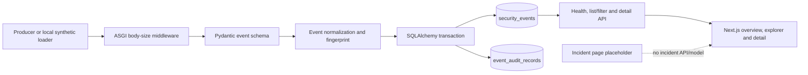

# SENTRIX — As-Is Architecture

**As of:** 2026-10-19
**Source baseline:** commit `d68e221`; current source reviewed during Phase A.
**Verification limits:** PostgreSQL runtime and browser integration were unavailable; see [Phase A report](../audit/PHASE_A_VERIFICATION_2026-10-19.md).

The 15 October audit documented an empty workspace and invalid Git metadata at that earlier snapshot. See [the historical audit](../audit/INITIAL_AUDIT.md); the architecture below describes the current source tree.

## Observed shape

SENTRIX is a local-development modular monolith: Next.js calls a versioned FastAPI API, which validates and normalizes event input and persists it through synchronous SQLAlchemy sessions. Alembic owns schema changes. PostgreSQL 16 is the intended local database; automated tests and Phase A migration checks use isolated SQLite.

## Code map and evidence

| Concern | Implementation |
|---|---|
| API app, middleware and errors | `services/api/src/sentrix/main.py` |
| Health and database probe | `services/api/src/sentrix/api/routes/health.py` |
| Ingest, list, filter, pagination and detail | `services/api/src/sentrix/api/routes/events.py` |
| Canonical schemas and fingerprint | `services/api/src/sentrix/events/schemas.py` |
| Normalize, persist, and transactionally add ingestion audit row | `services/api/src/sentrix/events/service.py` |
| Event and audit models | `services/api/src/sentrix/events/models.py` |
| Engine/session setup | `services/api/src/sentrix/db/session.py` |
| Schema revisions | `services/api/migrations/versions/0001_create_security_events.py`, `0002_event_audit_records.py` |
| Web app and API client | `apps/web/src/app/`, `apps/web/src/lib/api.ts`, `apps/web/src/components/` |
| Synthetic loader / retention command | `scripts/load_synthetic.py`, `scripts/purge_expired_events.py` |

The live API contract is `POST /api/v1/events`, `GET /api/v1/events`, `GET /api/v1/events/{event_id}`, and `GET /api/v1/health`. Listing has bounded page size and offset, stable order, event type/severity/source/fingerprint filters, and an event-time range. The web UI reads live API records and has loading, empty and failure states in source; those browser states have not been exercised in this environment.

## Data and trust boundaries

- The API accepts unauthenticated JSON. The body is capped before schema validation; canonical raw-event JSON also has its own serialized-size limit.
- Known canonical fields become columns. The submitted JSON object structure is retained in a JSON column; original bytes and key ordering are not retained.
- `event_timestamp` may be unknown. `observed_timestamp` defaults to receipt time, while `ingested_at` and `created_at` are server timestamps. Datetimes with offsets are normalized to UTC.
- `event_fingerprint` hashes canonical JSON content but is not unique and does not deduplicate. The UUID `id` identifies a persisted row, not a producer-level event.
- Ingestion audit metadata shares the event transaction and omits submitted telemetry. It uses a fixed actor class and does not provide caller identity or read audit.
- Request IDs are server-generated and returned in `X-Request-ID`; ingestion logs include the ID. There is no identity propagation or access audit.
- The documented local workflow binds the API and database port to loopback. CORS allows exact local web origins; CORS is not authentication. Any caller with network reachability can read raw event data.

## Operational and runtime constraints

The API handlers call synchronous SQLAlchemy methods from `async def` functions. A slow DB operation blocks the event loop for that process. Phase A confirmed this execution path by code inspection but did not characterize PostgreSQL load behavior; process-level HTTP was blocked by local socket restrictions. Do not treat the app as shared/high-throughput until a concurrency test and a threadpool or async DB approach are in place.

Current dynamic verification is limited to 19 isolated SQLite API tests, an SQLite migration upgrade/drift check, Python lint/format/syntax checks, and Compose configuration parsing. PostgreSQL, browser build/rendering, and full process E2E remain unverified. See the dated verification report for exact evidence.

There is no event bus, search service, graph store, correlation worker, incident aggregate, identity service, or response automation in the current code. These remain future decisions; the next correlation phase must satisfy the [readiness contract](../CORRELATION_READINESS.md) before changing the model.
