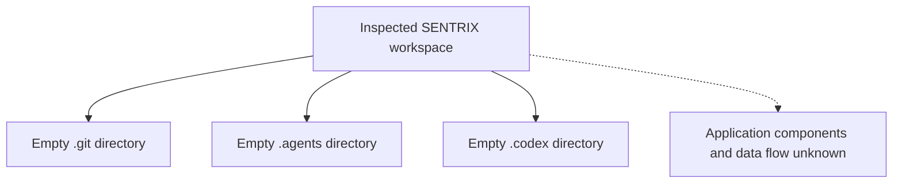

# SENTRIX — As-Is Architecture

**As of:** 2026-10-15  
**Status:** Architecture not verifiable from the current workspace.

## Observed workspace

The inspected workspace contains no application source, project configuration, dependency manifests, or runtime entry point. It contains only empty `.git`, `.agents`, and `.codex` directories. The `.git` directory is not valid Git metadata. No application data flow can therefore be established from implementation evidence.

## Component inventory

| Architecture concern | Observed state |
|---|---|
| Frontend | No frontend artifacts found |
| Backend/API | No backend or API artifacts found |
| Persistence | No schema, database configuration, or migrations found |
| Ingestion/normalization | No source artifacts found |
| Correlation/incident handling | No source artifacts found |
| Evaluation | No datasets, ground truth, or evaluation code found |
| Deployment/runtime | No executable entry point or deployment configuration found |

These observations apply only to the visible workspace. They do not prove that a remote, another branch, or another checkout lacks these components.

## Unknowns to resolve from the intended source tree

Language and framework; service boundaries; entry points; API contracts; data stores; event and entity models; ingestion sources; normalization and correlation flow; incident lifecycle; frontend integration; authentication and authorization; evaluation workflow; deployment and operational controls.

## Audit implication

Do not infer an as-is architecture or prescribe a migration from this snapshot. Once the intended source is available, update this document from concrete code paths and verified execution behavior, separating observed facts from unresolved questions.
