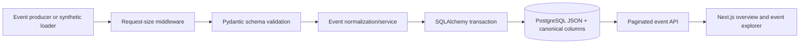

# Foundation MVP — Implemented Architecture

## Shape

SENTRIX is a modular monolith with a Next.js App Router frontend and one FastAPI backend. The API separates HTTP routes, configuration/logging, persistence, and the event domain service. PostgreSQL is the local application store; Alembic owns schema changes.

## Module boundaries

- `apps/web`: presentation, API client, event list and detail UI.
- `services/api/src/sentrix/api`: versioned routes and HTTP error handling.
- `core`: validated settings and structured logging.
- `db`: engine, declarative base, UTC timestamp type, request-scoped sessions.
- `events`: request/response schema, SQLAlchemy model, normalization and persistence use case.
- `incidents`: reserved domain namespace; incident behavior does not exist yet.
- `services/api/migrations`: versioned schema lifecycle.

## Data and trust boundaries

Submitted event JSON is untrusted input and is bounded before Pydantic parsing. Known canonical fields are validated and stored in columns. The entire submitted JSON object is retained structurally in a JSON column for provenance; its original byte formatting and key order are not preserved. Database access uses SQLAlchemy parameters. The unauthenticated API is bound to loopback in documented development commands.

## Deferred architecture

There is no event bus, search cluster, graph store, correlation worker, incident aggregate, or authentication service. No service boundary has yet been demonstrated to require distribution.

The initial HTTP handlers currently call the synchronous SQLAlchemy session directly from async route functions. This keeps the small development slice executable in constrained local test environments, but can block the event loop during slow database operations. Before shared or higher-throughput use, move to synchronous FastAPI endpoints (thread-pool dispatch) or an async SQLAlchemy driver after measuring and testing the deployment environment.
